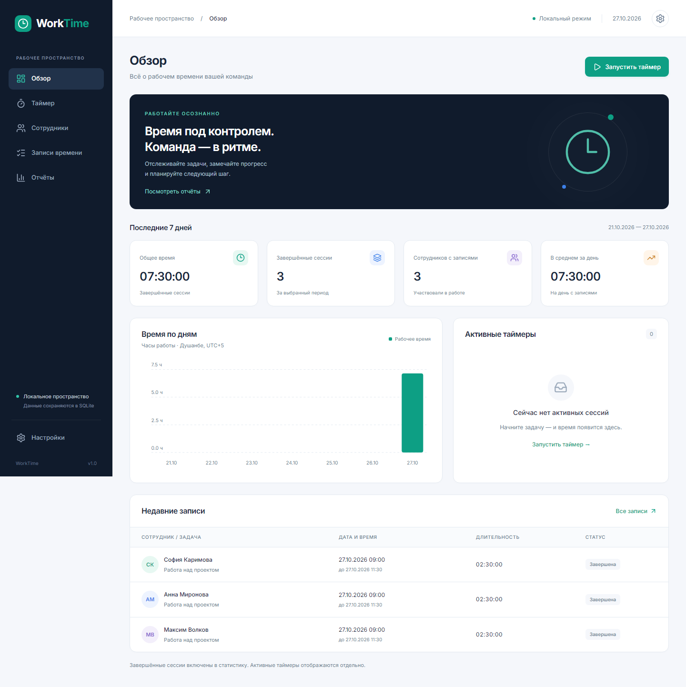
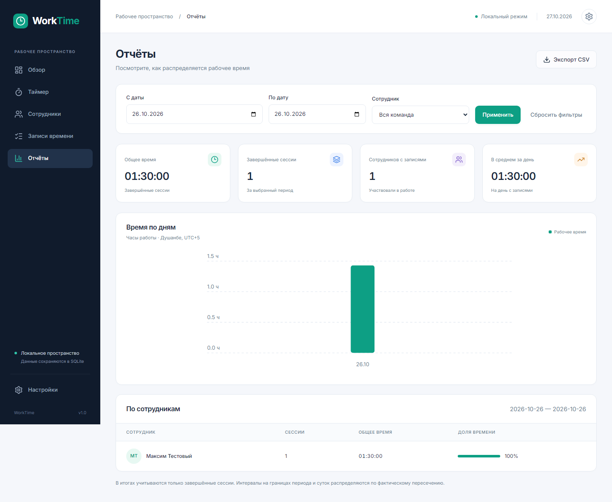
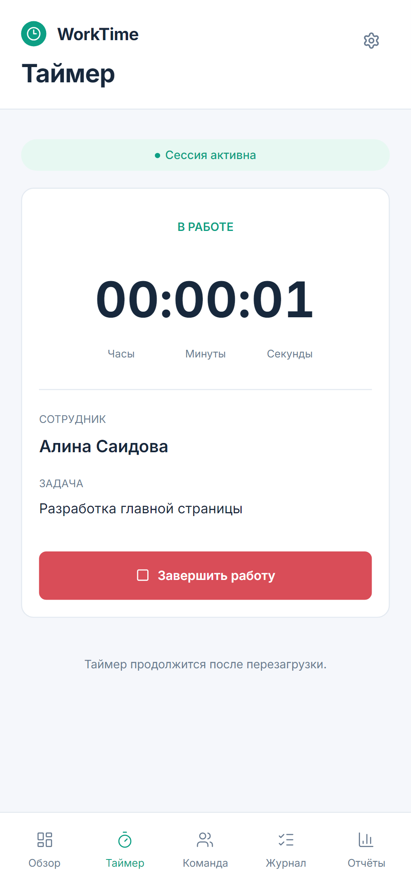

# WorkTime

**Employee time tracking, made simple.**

WorkTime is a responsive web application for managing a small team, recording time spent on tasks, and generating employee and date-based reports. It was built as a technical assessment project with an emphasis on **reliable timers, persistent data, understandable UI, and verifiable tests**.

**No sign-up, login, paid services, or Docker required.** The application is designed for local evaluation with fictional employee data.



**Explore the interface:** [Desktop reports](docs/screenshots/reports-desktop.png) · [Employees](docs/screenshots/employees-desktop.png) · [Active mobile timer](docs/screenshots/android-03-timer-active.png) · [Mobile dashboard](docs/screenshots/android-01-overview.png) · [All mobile states](docs/MOBILE_UI.md)

## Key features

| Area | What WorkTime does |
| --- | --- |
| **Dashboard** | Shows team activity, recent time entries, and key totals. |
| **Employees** | Add, search, edit, view profiles, archive, and restore employees. Duplicate names are allowed; employees have unique IDs. |
| **Time tracking** | Start a timer for a selected employee with a task description, watch elapsed time, and stop with confirmation. |
| **Reliable sessions** | Time is recorded on the server and survives page reloads and server restarts. Only one active timer is allowed per employee; different employees can track simultaneously. |
| **Time entries** | Browse, filter, paginate, inspect, add completed entries manually, edit, and delete completed entries with confirmation. |
| **Reports** | Filter by employee and dates; view totals, session counts, daily breakdowns, employee comparisons, and useful empty states. |
| **Exports and backups** | Export filtered time data as CSV; export, import, and clear SQLite-backed data through guarded JSON workflows. |
| **Responsive UI** | Desktop layouts, mobile-friendly navigation and forms, accessible dialogs, focus states, and actionable error messages. |

Employees are **records for time tracking**, not accounts. Authentication and user roles are intentionally out of scope for this assessment.

## Tech stack

| Layer | Technology |
| --- | --- |
| Frontend | React, TypeScript, Vite, React Router |
| UI and state | CSS, Lucide icons, TanStack Query, Inter |
| Backend | Node.js, Express, TypeScript |
| Validation | Zod |
| Database | SQLite via `better-sqlite3` |
| Date and time | Luxon, with explicit `Asia/Dushanbe` reporting timezone |
| Testing | Vitest, Supertest, Playwright (Chromium) |
| Tooling | ESLint, TypeScript, Prettier |

The application uses a **single SQLite database as its source of truth**. Working data is not stored in `localStorage`.

## Quick start

### Requirements

- **Node.js 24.14.0 or newer** (as required by `package.json`)
- npm (tested with **11.9.0**)
- Windows 11, or another environment compatible with the project's dependencies

From the root of the cloned project:

```bash
npm ci
npm run dev
```

Open **http://127.0.0.1:5173** in your browser.

- **Frontend (Vite):** `http://127.0.0.1:5173`
- **API health check:** `http://127.0.0.1:3001/api/health`
- Vite proxies `/api` requests to the Express server.
- Press **Ctrl+C** in the terminal to stop the development servers.

The database is created automatically on first launch and starts **empty**. No credentials or environment file are required for the default local setup.

### Try the main workflow

1. Open **Employees** and add a fictional employee.
2. Open **Timer**, select that employee, and describe the task.
3. Start the timer, wait a little, and **refresh the browser**. The timer should still be running.
4. Stop the timer and open **Time Entries** to find the completed session.
5. Open **Reports**, choose a date range, and click **Apply** to see the recorded duration.
6. Restart the application: saved employees and sessions should still be present.

Optional fictional seed data can be added explicitly:

```bash
npm run seed
```

The seed command refuses to populate a non-empty database. Restarting WorkTime never automatically inserts demo data.

## Production-style local run

```bash
npm run build
npm start
```

Open **http://127.0.0.1:3001**. In this mode, Express serves the built frontend and the API from the same server. Stop `npm run dev` first if it is still using port `3001`.

> **Scope:** This is a local technical assessment project, not a hardened multi-user public service. No live public deployment is provided. Do not expose the unauthenticated instance to the internet or enter real employee information.

## Screenshots

| Desktop | Mobile |
| --- | --- |
|  |  |
| [Employees](docs/screenshots/employees-desktop.png) · [Timer](docs/screenshots/timer-desktop.png) | [Overview](docs/screenshots/android-01-overview.png) · [Team](docs/screenshots/android-05-team.png) · [Reports](docs/screenshots/android-08-reports.png) |

See the [mobile UI guide](docs/MOBILE_UI.md) for the ten documented mobile states, plus the [screen map](docs/SCREEN_MAP.md) for navigation and state coverage.

## Automated testing

**Latest independently executed results (Windows 11, 27 October 2026):**

| Check | Command | Result |
| --- | --- | --- |
| Lint | `npm run lint` | Passed |
| TypeScript | `npm run typecheck` | Passed |
| API, backup, and persistence tests | `npm test` | **15 / 15 passed** (3 test files) |
| Production build | `npm run build` | Passed |
| Browser end-to-end tests | `npm run test:e2e` | **9 / 9 passed** (desktop and mobile profiles) |

The automated scenarios include adding employees; starting, refreshing, stopping, and restarting timers; preventing duplicate sessions; date-filtered and empty reports; entry editing; backup/restore; network errors; and mobile layouts.

### Run the checks yourself

```bash
npm run lint
npm run typecheck
npm test
npm run build
```

Playwright requires Chromium and a completed production build. For **Windows PowerShell**, keeping the browser installation inside the project:

```powershell
$env:PLAYWRIGHT_BROWSERS_PATH = Join-Path (Get-Location) '.cache/browsers'
npx playwright install chromium
npm run test:e2e
```

End-to-end tests use an isolated test database on port `3007`; they do not intentionally modify the main database at `server/data/worktime.sqlite`.

An additional clean-install check is available:

```bash
npm run check:clean
```

See [TEST_REPORT.md](docs/TEST_REPORT.md) for the test matrix, observed defects, fixes, and coverage limitations. Browser emulation does not establish compatibility with physical Android devices or Safari.

## Data integrity and time calculations

- The default SQLite file is `server/data/worktime.sqlite`, excluded from Git along with journal files.
- Session timestamps are stored in **UTC** at whole-second precision.
- Date pickers and calendar reports use **Asia/Dushanbe** independently of the operating system's timezone.
- Reports count **completed sessions only**. An active timer is not counted toward completed work time.
- Reports include only the part of each completed session overlapping the selected date interval. For example, a **23:50–00:20** session contributes **10 minutes** to the first day and **20 minutes** to the next.
- The selected end date is inclusive. Report periods are limited to **366 days**.
- An empty report displays `00:00:00` without invalid averages.
- The database includes migrations, foreign keys, WAL mode, and constraints that prevent a second active session for the same employee.
- CSV uses UTF-8 with BOM and `;` separators for Excel compatibility, and escapes potentially unsafe spreadsheet formula prefixes.

Backup import is a **complete replacement**, not a merge. The importer checks the file and uses a transaction so an invalid backup does not partially replace the database. Export a backup before replacing or clearing data.

## Configuration

A `.env` file is optional. Defaults work for local development; see [.env.example](.env.example).

| Variable | Default | Purpose |
| --- | --- | --- |
| `HOST` | `127.0.0.1` | Express bind address |
| `PORT` | `3001` | API and local production server port |
| `DATABASE_PATH` | `server/data/worktime.sqlite` | SQLite file path, relative to the project root |
| `DEMO_MODE` | `false` | Disables JSON import and mass deletion when enabled |

`DEMO_MODE` **does not add authentication or protect other endpoints**. If the API port is changed, update Vite's proxy and the relevant allowed local origins.

### Installation troubleshooting on Windows

If `npm ci` fails with `EPERM` while replacing the `better-sqlite3` native binary, close running WorkTime/Node processes and terminals that may be using it, then reopen PowerShell and try:

```powershell
Remove-Item -LiteralPath '.\node_modules' -Recurse -Force
npm ci
```

If Windows still refuses to delete a locked file, restart the computer before retrying. This does **not** require deleting the SQLite database or source files.

If installation runs out of temporary space on the system drive, project-local npm cache settings are already supplied in `.npmrc`. In PowerShell, temporary files may also be redirected to the project drive:

```powershell
New-Item -ItemType Directory -Force '.cache/tmp' | Out-Null
$env:TEMP = Join-Path (Get-Location) '.cache/tmp'
$env:TMP = $env:TEMP
npm ci
```

The project's `.npmrc` disables dependency lifecycle scripts and uses available prebuilt binaries. This was tested with the specified Windows/Node environment; other systems may require adjustments.

## Project structure

```text
worktime/
├── client/
│   └── src/
│       ├── app/          # Routes
│       ├── components/   # Shared UI
│       ├── features/     # Dashboard, timer, employees, entries, reports, settings
│       │   └── mobile/   # Compact mobile views
│       ├── lib/          # API client and UI utilities
│       └── styles/       # Global and responsive styling
├── server/
│   └── src/
│       ├── db/           # SQLite schema and migrations
│       ├── modules/      # Report calculations
│       ├── validation.ts # Zod input validation
│       └── app.ts        # HTTP API
├── shared/               # Shared models and time helpers
├── tests/                # API, persistence, browser E2E tests
├── docs/                 # API, AI usage, test reports, screenshots
├── package.json
└── README.md
```

Main routes: `/`, `/timer`, `/employees`, `/employees/:id`, `/entries`, `/reports`, and `/settings`. On compact layouts (up to `1023px`), creation forms also use `/timer/new` and `/employees/new`.

For the complete HTTP contract and examples, see [API.md](docs/API.md).

## Design reference

[**WorkTime — Figma UI/UX design**](https://www.figma.com/design/Cj8MbOLCq4FAeI19G9aMj3)

The implementation follows the supplied design specifications and was refined using a visual reference for ten mobile screens. **Pixel-perfect correspondence with the Figma source layers has not been verified**, because access to design-context exports was rate-limited. The provided screenshots show the **implemented application**, not Figma exports.

## AI-assisted development

AI was used transparently as part of development and verification:

- **Codex** assisted with application code, backend logic, tests, and documentation.
- The implementation was based on a written technical specification and a supplied starter prompt.
- Documented fixes include npm installation issues, React render-time purity, ambiguous Playwright selectors, report edge cases, and error display when the API is unavailable.
- The prompt examples in the development log are **real excerpts from the supplied starter instructions**, not invented separate conversations.

See [AI_USAGE.md](docs/AI_USAGE.md) for the development account, prompt excerpts, technical decisions, and corrections. The project does not claim independently verified use of any additional models or agents.

## Documentation

- [API reference](docs/API.md)
- [Screen map](docs/SCREEN_MAP.md)
- [Mobile UI and states](docs/MOBILE_UI.md)
- [Test results and fixes](docs/TEST_REPORT.md)
- [AI usage and prompt examples](docs/AI_USAGE.md)

## Known limitations

- No user authentication, passwords, or role-based permissions — **by design for this assessment**.
- No public hosted demo yet; reviewers can run the application locally.
- JSON import replaces all data; merge import is not supported.
- The reporting timezone is fixed to `Asia/Dushanbe`.
- Designed for a small local team, not an exposed internet-facing service.
- Physical Android hardware and Safari were not part of the reported automated test matrix.

---

**WorkTime** — an employee time-tracking technical assessment project. Source code, setup instructions, tests, and AI-assisted development notes are provided for review.
